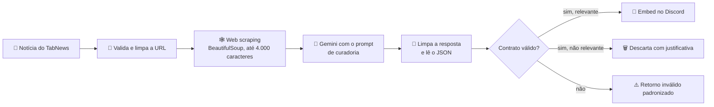

# 🤖 Bot Tech Girls: minha contribuição (agente de IA)

> Este repositório é o meu fork do [discord-bot-tech-girls](https://github.com/thaisattico/discord-bot-tech-girls), um bot de Discord feito em equipe pela comunidade **Tech Girls** (Thais, Maria, Andressa e eu) para compartilhar notícias de tecnologia e vagas da área.
>
> **Minha parte foi a integração de inteligência artificial:** o agente que lê cada notícia, decide se ela é relevante para a comunidade, resume e devolve um JSON validado para o bot publicar no Discord.


**7 pull requests aceitos no projeto original** ([ver os PRs](https://github.com/thaisattico/discord-bot-tech-girls/pulls?q=is%3Apr+author%3Abyluxp)).

---

## 🧠 O agente de curadoria de notícias

Arquivo principal: [`src/services/app_validador.py`](src/services/app_validador.py) · Prompt: [`docs/leitura_de_noticias.md`](docs/leitura_de_noticias.md)



### O que eu construí
- **Prompt de curadoria** com o papel de curadora da comunidade: o que aprovar (linguagens e ferramentas, IA e dados, carreira e vagas, tutoriais, mulheres na tecnologia) e o que descartar (publicidade, fofoca corporativa, política, promoções).
- **Saída estruturada em JSON**, pedida ao modelo com `response_mime_type="application/json"`:
  ```json
  {
    "relevante": true,
    "titulo": "Título da notícia",
    "tags": ["IA", "Python"],
    "texto-resumo": "Linha 1.\nLinha 2.\nLinha 3.",
    "link-de-acesso": "https://..."
  }
  ```
- **Validação do contrato antes de publicar**, porque um LLM nem sempre segue o formato:
  - `relevante` precisa ser booleano; se for `false`, a `justificativa` é obrigatória;
  - resumo com **exatamente 3 linhas** e no máximo 15 palavras por linha;
  - no máximo 3 tags, sem repetição;
  - URL válida.
  Qualquer falha vira um retorno padronizado, e o bot nunca publica algo quebrado.
- **Robustez:** remove blocos de Markdown que o modelo às vezes devolve, tenta outro modelo quando um falha e faz o scraping em outra thread para não travar o bot.
- **Testes de validação** do retorno para os embeds e a **conteinerização com Docker** para a equipe rodar o bot do mesmo jeito.

### Também comecei
- **Busca de vagas** ([`src/services/jobs_search.py`](src/services/jobs_search.py)): integração com a API JSearch (RapidAPI) filtrando vagas de tecnologia no Brasil. Ficou parcialmente concluída.

---

## 👥 O restante do projeto

A estrutura do bot (comandos de configuração, tarefas agendadas, banco SQLite, fila de notícias e canais de vagas) foi feita pelas outras integrantes da equipe. Documentação completa e instruções para rodar: [repositório original](https://github.com/thaisattico/discord-bot-tech-girls).
