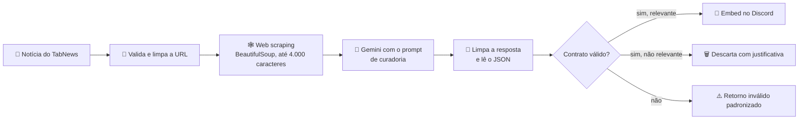
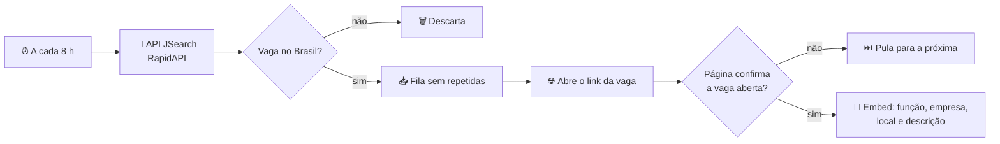

# 🤖 Bot Tech Girls: minha contribuição

> Este repositório é o meu fork do [discord-bot-tech-girls](https://github.com/thaisattico/discord-bot-tech-girls), um bot de Discord feito em equipe pela comunidade **Tech Girls** (Thais, Maria, Andressa e eu) para compartilhar notícias de tecnologia e vagas da área.
>
> **Minha parte foi:**
> 1. **a automação do robô com IA:** o agente que lê cada notícia, decide se ela é relevante para a comunidade, resume e devolve um JSON validado para o bot publicar no Discord;
> 2. **a configuração e a ativação da pesquisa de vagas:** busca na API JSearch, conferência de cada vaga no link antes de postar e ajuste às cotas gratuitas;
> 3. **a documentação de testes do robô:** casos de teste medidos antes e depois de cada mudança, com os resultados registrados.


**7 pull requests aceitos no projeto original** ([ver os PRs](https://github.com/thaisattico/discord-bot-tech-girls/pulls?q=is%3Apr+author%3Abyluxp)), mais o [#14](https://github.com/thaisattico/discord-bot-tech-girls/pull/14), em revisão, com a pesquisa de vagas e os testes.

---

## 1. 🧠 Automação do robô com IA: curadoria de notícias

Arquivo principal: [`src/services/app_validador.py`](src/services/app_validador.py) · Prompt: [`docs/leitura_de_noticias.md`](docs/leitura_de_noticias.md)



### O que eu construí
- **Prompt de curadoria** com o papel de curadora da comunidade: o que aprovar (linguagens e ferramentas, IA e dados, carreira e vagas, tutoriais, mulheres na tecnologia) e o que descartar (publicidade, fofoca corporativa, política, promoções).
- **Saída estruturada em JSON**, pedida ao modelo com `response_mime_type="application/json"`:
  ```json
  {
    "relevante": true,
    "titulo": "Título da notícia",
    "tags": ["IA", "Python"],
    "texto-resumo": "Linha 1.\nLinha 2.\nLinha 3.",
    "link-de-acesso": "https://..."
  }
  ```
- **Validação do contrato antes de publicar**, porque um LLM nem sempre segue o formato:
  - `relevante` precisa ser booleano; se for `false`, a `justificativa` é obrigatória;
  - resumo com **exatamente 3 linhas** e no máximo 15 palavras por linha;
  - no máximo 3 tags, sem repetição;
  - URL válida.
  Qualquer falha vira um retorno padronizado, e o bot nunca publica algo quebrado.
- **Robustez:** remove blocos de Markdown que o modelo às vezes devolve, tenta outro modelo quando um falha e faz o scraping em outra thread para não travar o bot.
- **Escolha do modelo com medição:** comparei os modelos do Gemini em 18 notícias reais com a resposta esperada. O `gemini-3.5-flash-lite` acertou **15 de 18, sem erros de API, em 3,1 s por notícia**. O modelo anterior parou depois de 4 respostas, porque o plano gratuito dos modelos flash aceita só 20 pedidos por dia.
- **Sem gasto repetido de cota:** notícias já avaliadas não voltam para a IA a cada ciclo nem são postadas duplicadas.
- **Conteinerização com Docker** para a equipe rodar o bot do mesmo jeito.

---

## 2. 💼 Configuração e ativação da pesquisa de vagas

Arquivos: [`src/services/jobs_search.py`](src/services/jobs_search.py) · [`src/cogs/jobs_tasks.py`](src/cogs/jobs_tasks.py) · [`src/utils/embeds.py`](src/utils/embeds.py)



### O que eu fiz
- **Comecei a integração** com a API JSearch (RapidAPI), filtrando vagas de tecnologia no Brasil.
- **Coloquei a pesquisa para funcionar.** Ela não postava nada por causa de três bugs:
  - um `return []` de teste que jogava fora todas as vagas;
  - o módulo de vagas que nunca era carregado no bot;
  - um `None` no lugar de lista quando faltava a chave da API.
- **Ativação no Discord:** o `/setupjobs` e o `/setupnews` davam erro quando o servidor já tinha canal configurado. Agora eles trocam o canal e iniciam as tarefas.
- **Cota gratuita respeitada:** o plano grátis da RapidAPI dá 200 requisições por mês, e a busca rodava a cada 1 minuto. Agora roda a cada 8 horas: no pior caso, 180 por mês.
- **Vaga conferida antes de postar:** o bot acessa o link de cada vaga e lê a descrição na própria página (bloco padrão `JobPosting`). Vagas encerradas, vencidas ou sem descrição confirmada não são postadas. Com vagas reais, **8 de 10 foram confirmadas**, em cerca de 2 s cada.
- **Mensagem completa:** cada vaga chega com o **nome da função, a empresa, o local e a descrição**, mais o botão para o site da vaga.

---

## 3. 🧪 Documentação de testes do robô

Registro completo: [`TESTES.md`](TESTES.md) · Testes: [`tests/`](tests)

Toda mudança segue o mesmo processo: **rodo os casos de teste antes de mudar (marco zero), mudo, rodo os mesmos casos de novo e registro o antes e depois**, com o que falhou e por quê.

| Mudança | Antes | Depois |
|---|---|---|
| Pesquisa de vagas voltando a funcionar | 3 / 15 testes | 15 / 15 |
| Bloqueios para rodar o bot completo (setup, cotas, notícias repetidas) | 1 / 7 | 7 / 7 |
| Vaga com empresa e descrição conferida no link | 0 / 12 | 12 / 12 |
| Modelo do agente de notícias (18 notícias reais) | 4 / 18 respondidas | 15 / 18 acertos |

- **34 testes automatizados com `pytest`**, com a API de vagas, as páginas das vagas e o Discord simulados (sem rede e sem gastar cota).
- **Avaliação de modelos de IA** ([`tests/avaliar_modelos_ia.py`](tests/avaliar_modelos_ia.py)): mede acertos, JSON válido, erros de API, tempo e tokens de cada modelo num conjunto fixo de notícias.
- **Testes com dado real viram casos fixos:** duas falhas que só apareceram com vagas reais entraram na suíte (descrição com HTML escapado e uma vaga aberta recusada por causa de um formulário de "denunciar vaga expirada").
- **Os testes também corrigem as minhas contas:** eu propus buscar vagas a cada 4 horas, e o teste da cota mostrou que o pior caso daria 360 requisições por mês, acima das 200 do plano. Por isso ficou em 8 horas.

```bash
python -m pytest
```

---

## 👥 O restante do projeto

A estrutura do bot (comandos de configuração, tarefas agendadas, banco SQLite, fila de notícias e canais) foi feita pelas outras integrantes da equipe. Documentação completa e instruções para rodar: [repositório original](https://github.com/thaisattico/discord-bot-tech-girls).
